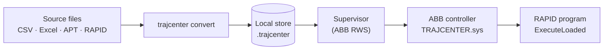

<!--
SPDX-FileCopyrightText: 2026 Josselin Schumacker, Clément Racinet

SPDX-License-Identifier: X11
-->

<div align="center">

<h1>TrajCenter</h1>

<p><strong>Prepare, store and transfer industrial trajectories to ABB robots.</strong></p>

<p>
  
  
  
  
  <a href="https://archive.softwareheritage.org/browse/origin/?origin_url=https://gitlab.ensam.eu/lcfc/trajcenter">
    
  </a>
</p>

<p>
  <a href="#installation">Installation</a> ·
  <a href="#quick-start">Quick start</a> ·
  <a href="#command-line-reference">CLI</a> ·
  <a href="#rapid-integration">RAPID</a> ·
  <a href="#development">Development</a> ·
  <a href="#reference-and-citation">Cite</a>
</p>

</div>

---
TrajCenter is a Python and RAPID toolchain for preparing and transferring industrial trajectories to ABB RobotWare 6.x controllers through **ABB Robot Web Services (RWS)**.

> **Version:** 2.0  
> **Developed at:** LCFC — Arts et Métiers  
> **Authors:** Josselin Schumacker and Clément Racinet  
> **Tested with:** ABB RobotWare 6.08 and 6.15

## Features

- Convert CSV, Excel, APT and RAPID files to `.trajcenter` archives.
- Manage a local trajectory store.
- Export archives to CSV or Excel.
- Use a command-line interface or a terminal interface (TUI).
- Supervise transfers to an ABB controller.
- Expose loaded trajectories to RAPID programs.

## How it works



---

## Documentation

The complete user and integration manual is available in `doc_manual/`.
It covers:

- installation and configuration;
- CLI and terminal interface usage;
- ABB RWS supervision;
- RAPID integration;
- trajectory execution;
- process integration;
- troubleshooting and error codes.

This README only provides the essential setup and commands.

---

## Installation

The project uses [Pixi](https://pixi.sh/) to manage Python and its
dependencies. Choose the environment that matches your workstation:

| Workstation         | Use case                                                    | Command                |
| ------------------- | ----------------------------------------------------------- | ---------------------- |
| **Preparation**     | Conversion, export, store management and terminal interface | `pixi install -e tui`  |
| **Robot-connected** | All local features and ABB robot supervision                | `pixi install -e full` |
| **Development**     | Tests, linting, type checking and documentation             | `pixi install -e dev`  |

---

## Quick start

### 1. Convert a trajectory

```powershell
pixi run -e full trajcenter convert `
    trajectory_files/test_basic.xlsx `
    trajectory_store
```

The resulting archive is created in `trajectory_store/`.

### 2. Check the local store

```powershell
pixi run -e full trajcenter store list `
    --store trajectory_store
```

### 3. Configure the ABB connection

Create a local file such as `robot.env`:

```dotenv
RWS_HOST=192.168.125.1
RWS_PORT=80
RWS_USER="Default User"
RWS_PASSWORD=robotics
RWS_TIMEOUT=10.0

TRAJCENTER_RWS_TASK=T_ROB1
TRAJCENTER_RWS_MODULE=TRAJCENTER
TRAJCENTER_STORE_ROOT=trajectory_store

TRAJCENTER_MASTERSHIP_RETRIES=3
TRAJCENTER_LOG_LEVEL=INFO
```

> **Security:** do not commit production credentials.

### 4. Start the supervisor

```powershell
pixi run -e full trajcenter robot supervise `
    --env-file robot.env
```

### 5. Request and execute a trajectory from RAPID

Load `rapid/TRAJCENTER.sys` as a system module, then use the public API:

```rapid
TRAJCENTER_InitErrors;
TRAJCENTER_InitCellConfig;

TRAJCENTER_RequestMetaRefresh;
TRAJCENTER_WaitRequestDone 30;

IF transferError = TRUE THEN
    TPWrite lastError;
    Stop;
ENDIF

TRAJCENTER_RequestTrajByName "test_basic";
TRAJCENTER_WaitTrajectoryReady 120;

! Perform cell-specific safety checks here.

TRAJCENTER_ExecuteLoaded 500, 5000, 1000;
```

> **Safety warning:** a successful transfer does not guarantee reachability,
> collision avoidance or safe execution. Validate trajectories in RobotStudio
> or at reduced speed before production use.

---

## Terminal interface

Launch the Textual terminal interface with:

```powershell
pixi run trajcenter-tui
```

It provides access to trajectory conversion, archive export, local store inspection, ABB robot supervision and session settings.
Robot supervision requires the `full` environment.

---

## Command-line reference

Display the general help:

```powershell
pixi run -e full trajcenter --help
```

| Command                      | Purpose                        |
| ---------------------------- | ------------------------------ |
| `trajcenter version`         | Display the installed version  |
| `trajcenter convert`         | Convert a source file          |
| `trajcenter export`          | Export a `.trajcenter` archive |
| `trajcenter store list`      | List local archives            |
| `trajcenter store inspect`   | Inspect one archive            |
| `trajcenter tui`             | Launch the terminal interface  |
| `trajcenter robot check`     | Check ABB support availability |
| `trajcenter robot supervise` | Start ABB RWS supervision      |

Use `--help` after any command to display its options:

```powershell
pixi run -e full trajcenter robot supervise --help
```

---

## RAPID integration

The robot-side interface is provided by `rapid/TRAJCENTER.sys`. Demonstration programs are also available in `rapid/`.

The main RAPID workflow is:

1. initialize TrajCenter;
2. configure tools, workobjects and defaults;
3. refresh the trajectory catalogue;
4. request a trajectory by name or index;
5. wait for the completed transfer;
6. validate the loaded data;
7. execute it with `TRAJCENTER_ExecuteLoaded`.

`TRAJCENTER_ExecuteLoaded` is the single recommended execution entry point. It supports trajectories with the `NONE` process and provides dispatching for
future process-specific implementations.

Refer to the manual before modifying the RAPID module or its RWS variables.

---

## Repository structure

```text
trajcenter/
├── doc_manual/          # User and integration manual
├── rapid/               # RAPID system module and demonstrations
├── scripts/             # Launchers and examples
├── tests/               # Automated test suite
├── trajcenter/          # Python package
├── trajectory_files/    # Example source files
├── trajectory_store/    # Local .trajcenter archives
├── trajectory_exports/  # Export destination
├── pixi.toml
├── pyproject.toml
└── README.md
```

---

## Development

Run the standard validation commands before committing:

```powershell
pixi run -e dev pyinit-write
pixi run -e dev ruff check .
pixi run -e dev typecheck
pixi run -e dev tests
```

Main contribution rules:

- use Pixi-managed environments;
- keep Python code typed and tested;
- keep Ruff and mypy checks clean;
- use mocks for automated RWS tests;
- perform RAPID writes under Mastership;
- keep the Python and RAPID protocol definitions synchronized;
- do not reintroduce the TrajCenter v1 TCP protocol.

---

## Reference and Citation

[](https://archive.softwareheritage.org/browse/origin/?origin_url=https://gitlab.ensam.eu/lcfc/trajcenter)

TrajCenter is archived in [Software Heritage](https://www.softwareheritage.org/), which provides a permanent, citable identifier (SWHID) for the source code. If you use TrajCenter in your work, please cite it as:

> Schumacker, J., & Racinet, C. (2026). _TrajCenter_ (Version 2.0) [Computer software].
> LCFC, Arts et Métiers.
> https://gitlab.ensam.eu/lcfc/trajcenter
> SWHID: `swh:1:snp:c02342c5c509cb366445162abecbf868465ba7d5;origin=https://gitlab.ensam.eu/lcfc/trajcenter`

<details>
<summary><strong>BibTeX</strong></summary>

```bibtex
@software{trajcenter2026,
  author    = {Schumacker, Josselin and Racinet, Cl{\'e}ment},
  title     = {{TrajCenter}},
  version   = {2.0},
  year      = {2026},
  publisher = {LCFC, Arts et M{\'e}tiers},
  url       = {https://gitlab.ensam.eu/lcfc/trajcenter},
  swhid     = {swh:1:snp:c02342c5c509cb366445162abecbf868465ba7d5;origin=https://gitlab.ensam.eu/lcfc/trajcenter}
}
```

</details>

---

## License and attribution

TrajCenter was developed at LCFC — Arts et Métiers by
**Josselin Schumacker** and **Clément Racinet**.

This project is licensed under the **X11 License**. See the
[`LICENSE`](./LICENSE) file for details.
